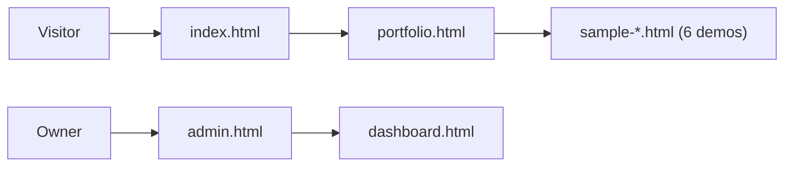

[← Back to README](./README.md)

# 404 Studio: Case Study

## Overview
- **What it is:** A multi-page website for 404 Studio, with a public portfolio, six live sample builds, and a dashboard/admin area.

## Tech Stack
| Layer | Choice | Why |
|---|---|---|
| Markup / UI | Plain HTML pages (no framework build step) | Fast to ship, zero tooling, easy to host anywhere |
| SEO | `robots.txt` + `sitemap.xml` | Crawlability from day one |

## Site Architecture

## Design Decisions
### 1. Static multi-page HTML over a framework
- **Alternatives:** React/Next.js, a CMS
- **Trade-off:** Shared header/footer is duplicated across pages

### 2. Sample sites as standalone pages
- **Why:** Each demo (e.g. Lumière + Lumière CRM) shows a different industry style and can be shared by its own URL
- **Trade-off:** More files to maintain

### 3. Separate dashboard and admin views

---
[← Back to README](./README.md)
